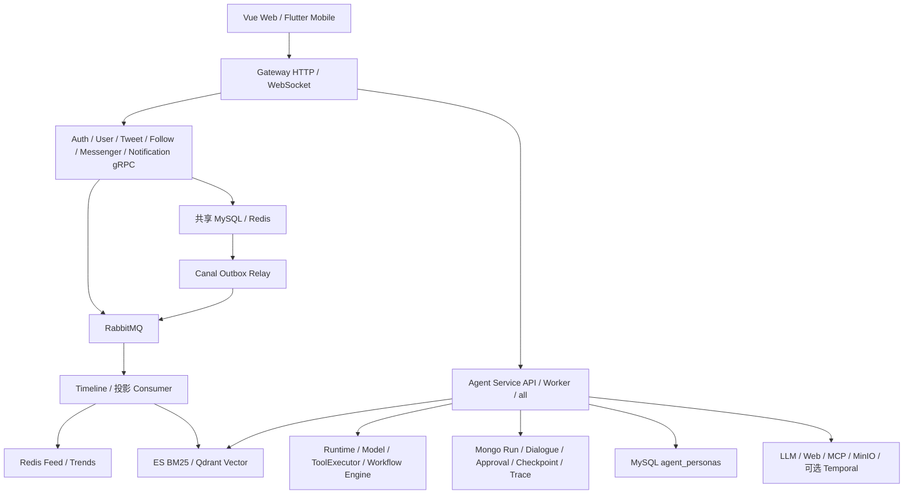

# 当前架构与功能实现评审（2026-10-12）

本次依据当前工作区（包括未提交修改）进行静态评审及定向离线验证。历史 `architecture_audit_report.md` 仅用于对照；未启动部署、访问真实 Provider/MCP、执行删除或发布。没有业务源码改动。

## 1. 结论

项目已经形成“社交业务后端 + 受治理 Agent 平台”的实际结构。Gateway 的业务 CRUD 已经通过 gRPC 接入；Agent Runtime、模型适配、工具治理、DAG 引擎与持久化有可辨认的边界。审批、幂等、执行预算、不可变 Workflow Revision、恢复及 Trace 的工程投入明显超过简单模型调用应用。

目前应定位为具备较多工程能力、仍需收口正确性和部署验收的演示/小规模 Beta 候选。不能据此宣称已经完成生产闭环或达到百万 DAU。最紧迫的工作是搜索可见性、Feed 完整性、事件持久化和分页契约；继续增加控制面或中间件的收益低于修复这些链路。

下面的风险为代码可达性判断，尚未通过真实存储故障注入复现。Implemented 指代码已实现，不代表已部署或真实业务验收通过。

## 2. 当前拓扑和边界

主要证据：`cmd/gateway/main.go:142`、`cmd/tweet-service/main.go:163`、`cmd/follow-service/main.go:118`、`cmd/agent-service/main.go:414`、`cmd/agent-service/main.go:939`、`internal/module/agent/startup/plan.go`。

- Gateway 当前没有历史报告中书签/通知的直接业务 SQL，已通过对应 gRPC Client 装配。保留 BFF 聚合是合理的。
- Tweet 仍注入 FollowRepository，Follow 仍注入 TweetRepository，并共享 Timeline Cache。服务进程拆分已经实现，数据所有权和派生状态所有权尚未完全隔离。
- Agent Runtime 核心通过 ModelClient、ToolExecutor、RAGSearcher、AdmissionController 等接口执行；DAG Scheduler 消费 IR、只读 StateView 与 Delta，协调器单写合并。应保留这些边界。
- Agent 已区分 API/Worker 生命周期，但 MySQL 等依赖仍在角色分支前装配。角色隔离不等于依赖隔离；API 启动仍依赖 MySQL Persona。
- Temporal 当前承担可选后台风控/热点任务，用户 DAG 仍由本地 Workflow Engine 执行。

## 3. 按优先级排序的发现

### F1 · P0 · 搜索与认知上下文绕过当前推文可见性

**证据：** [MCP 搜索回表兜底](E:/GOProject/cloud/twitter-clone/internal/module/agent/mcp/tools/search_tweets.go:164)、同文件 `367`；[知识检索](E:/GOProject/cloud/twitter-clone/internal/module/agent/workflow/rag/memory.go:439)；[ES 查询](E:/GOProject/cloud/twitter-clone/pkg/es/es.go:254)；[TweetService 权威读取](E:/GOProject/cloud/twitter-clone/internal/module/tweet/service/tweet_service_mq.go:367)。

语义/混合 MCP 搜索在 GetTweet 出错后，不区分“不存在/被隐藏”与暂时性故障，直接用索引正文构造成功结果。TweetService 对非作者的 Shadowban 返回不存在，这个拒绝会被搜索兜底绕过。MemoryManager.SearchHybridKnowledge 则直接把 ES/Qdrant 的正文转成上下文，不执行当前可见性校验；ES 查询也未使用 deleted_at/visible_type 过滤。

**影响：** 已删除或已治理内容可以继续进入搜索结果、结构化 Evidence、Reranker 或模型上下文。风险不依赖 Prompt Injection，发生在数据进入模型之前。

**建议：** 在 TweetService 提供统一、批量、带调用者身份的可读性校验；搜索只从合法候选产生正文和 Evidence。NotFound/不可见必须丢弃，权威服务不可用时明确降级或 blocked。索引过滤作为前置优化，不能代替事实源校验。Rerank 也应在可见性校验之后进行。

### F2 · P1 · 普通 Feed 在第一页错误地结束分页

**证据：** [GetFeeds](E:/GOProject/cloud/twitter-clone/internal/module/tweet/service/tweet_service_mq.go:699)、同文件 `747`；[Redis 查询 Count](E:/GOProject/cloud/twitter-clone/internal/module/tweet/cache/timeline_cache.go:90)；[Web 消费 has_more](E:/GOProject/cloud/twitter-clone/web/src/views/Home.vue:36)。

普通来源只取 limit 条，大 V 来源同样按 limit 取，合并后却使用 `len(mergedIDs) > limit` 判断 has_more。只有普通作者时，最多得到 limit 条，即使 Redis 有更多推文也返回 false。例如缓存有 50 条、请求 20 条，第一页后 Web 会停止加载。

过滤发生在裁切后，游标又从最终可见结果生成；一整页候选被过滤时，还可能出现空页/零游标，缺少候选扫描推进。

**建议：** 每个来源读取 limit+1；明确消费候选的边界，按稳定候选游标推进并有界补齐可见结果。补充纯普通、纯大 V、混合、重复、删除/隐藏及全页隐藏的分页测试。

### F3 · P1 · 大 V 晋升与 Feed 降级被仓储 100 条上限截断

**证据：** [晋升广播](E:/GOProject/cloud/twitter-clone/internal/module/follow/service/follow_service_mq.go:280)、[对账](E:/GOProject/cloud/twitter-clone/internal/module/follow/service/sync_job.go:35)、[仓储硬上限](E:/GOProject/cloud/twitter-clone/internal/module/follow/repository/follow_repo.go:99)、同文件 `178`；[Feed 拉取降级](E:/GOProject/cloud/twitter-clone/internal/module/tweet/service/tweet_service_mq.go:936)、[大 V 停止扇出](E:/GOProject/cloud/twitter-clone/internal/mq/consumer/timeline_consumer.go:634)。

晋升广播请求 6000 名粉丝，对账请求 55000 名，GetFollowers 都会截断到 100 名。作者被加入 global:celebrities 后停止写扩散，其余老粉丝却可能没有 user:celebrities 关联，因此漏掉后续推文。AlignCelebrityCache 同样无法修复全量关系；在已检查的生产 Follow 组合根中也未见该对账任务的注册。

Feed Redis 读取故障时，降级请求 1000 名关注对象，但 GetFollowees 同样只返回 100 名。此外，普通 Timeline key 缺失返回空列表而非错误，当前不会触发 MySQL 重建，缓存丢失可能表现为成功的空 Feed。

**建议：** 使用现有 ListFollowerPage 的关系 ID 游标模式进行可恢复分页，并补内部 FolloweePage；把晋升/降级传播做成有游标、重试和完成状态的持久任务。区分“已初始化且为空”与“缓存未初始化”；关系集合丢失需按数据库重建。

### F4 · P1 · 删除事件和索引删除没有持久化闭环

**证据：** [DeleteTweet](E:/GOProject/cloud/twitter-clone/internal/module/tweet/service/tweet_service_mq.go:333)；[删除消费](E:/GOProject/cloud/twitter-clone/internal/mq/consumer/timeline_consumer.go:711)；[创建投影](E:/GOProject/cloud/twitter-clone/internal/mq/consumer/timeline_consumer.go:1041)。

DeleteTweet 先删除 MySQL，再直接发布 MQ；发布失败只记录日志并返回成功。Consumer ACK 后异步删除 ES，失败不重试，该路径没有删除 Qdrant 点。延迟执行的 sync_es 创建任务也没有重新读取当前推文状态，能够在删除后用旧事件重新写入 ES/Qdrant。

**影响：** 删除传播可能永久缺失；创建/删除乱序可以让旧正文重新出现在索引中，加剧 F1。

**建议：** 删除和 TWEET_DELETED Outbox 同事务提交；ES/Qdrant 删除作为独立持久任务。投影需要实体版本/墓碑约束或写前重读当前状态，避免旧创建覆盖删除。验收包含“先删后重试创建”、ES 成功/Qdrant 失败、回执丢失与进程重启。

### F5 · P1 · Follow 分页输出与数据库 cursor 不同义

**证据：** [Service 返回用户 ID 作为 cursor](E:/GOProject/cloud/twitter-clone/internal/module/follow/service/follow_service_mq.go:199)、同文件 `226`；[Repository 按关系 ID 查询](E:/GOProject/cloud/twitter-clone/internal/module/follow/repository/follow_repo.go:106)、同文件 `187`。

数据库排序/过滤使用 Follow.ID，Service 却把最后一个 FollowerID/FolloweeID 作为下一页游标。用户创建时间与关注发生时间不同，第二页会漏项或重复。limit=100 时，Service 请求 101 条但 Repository 截成 100，也会错误地返回没有更多。

**建议：** 仓储返回有 next_cursor/has_more 的关系页，Proto uint64 字段仍可保持兼容，但必须统一其含义。使用“先创建用户、后交错关注”的数据验证；不能只用用户 ID 与关系 ID 同序的夹具。

### F6 · P1 · 私信分页属于未完成实现

**证据：** [GetConversations/GetMessages](E:/GOProject/cloud/twitter-clone/internal/module/messenger/service/messenger_service.go:69)；[Mobile 历史消息加载](E:/GOProject/cloud/twitter-clone/mobile/lib/features/chat/presentation/chat_room_screen.dart:102)。

两条读取都忽略 req.Cursor；会话列表固定 HasMore=false；消息列表按数量推测 HasMore，却不填 NextCursor。消息超过一页时客户端不能稳定加载更早历史，可能反复收到同一页。

**建议：** 使用稳定 `(created_at, id)` 或单调消息 ID cursor，limit+1 探测下一页；会话需单独定义按最新消息排序的语义。补 Web/Mobile 契约验收和相同时间戳测试。

### F7 · P1 · 点赞/评论热度投影在 ACK 后无界异步执行

**证据：** [点赞处理](E:/GOProject/cloud/twitter-clone/internal/mq/consumer/timeline_consumer.go:485)、[评论处理](E:/GOProject/cloud/twitter-clone/internal/mq/consumer/timeline_consumer.go:521)、[算分](E:/GOProject/cloud/twitter-clone/internal/mq/consumer/timeline_consumer.go:534)。

两类消息先 ACK，再使用 background goroutine 更新热度。崩溃或 Redis 失败会失去 Broker 重试机会；重复投递没有事件 ID 去重，用户频控不等于幂等。频控 INCR 和 EXPIRE 也不是原子操作。

**建议：** 复用 tweet.created 的“持久投影/成功后 ACK”治理方式，使用有界 worker 和事件级幂等；频控与投影可通过 Lua 原子化，配专用 Retry/DLQ。该问题影响派生热度，不意味着 MySQL 点赞/评论事实丢失。

### F8 · P1 · 关注派生状态依赖尽力发布与进程内 goroutine

**证据：** [Follow/Unfollow](E:/GOProject/cloud/twitter-clone/internal/module/follow/service/follow_service_mq.go:61)、同文件 `119`、`163`；`cmd/follow-service/main.go:118`。

关注关系提交后直接发 MQ，失败只警告；回填最近推文、清理取关推文和大 V 状态均用 goroutine 执行，缺少持久任务身份。取关只清理最近 100 条推文，GetFeeds 读取缓存结果时未重新核对普通作者的当前关注关系。

**影响：** Redis/进程故障后可能长期漏回填，或取关后仍展示旧缓存内容。服务返回成功与派生状态完成之间缺少可恢复进度。

**建议：** 关注事实与 Outbox 原子提交，Consumer 统一拥有派生状态；有界分页回填/清理，或读取时批量校验当前关注关系。消除 Service 与 Consumer 的重复 owner 后再调整吞吐。

### F9 · P2 · 微服务数据与 Agent 依赖隔离仍为 Partial

**证据：** `cmd/tweet-service/main.go:163`、`cmd/follow-service/main.go:118`、`internal/infrastructure/persistence/db.go:98`、`docker-compose.production.yaml:363`、同文件 `382`、`469`、`cmd/agent-service/main.go:414`。

服务共享 DB 配置/账号并跨用 Repository；多个进程启动时 AutoMigrate。Agent API 角色也无条件连接 MySQL。生产覆盖虽有内部网络和资源限制，仍是单机形态，不能据此证明数据服务故障隔离或独立扩展。

**建议：** 先明确 schema/表及派生缓存 owner，部署独立最小权限账号和专用迁移 Job；将 Persona 改为 Agent-owned Port，并按角色懒初始化。逐步用 gRPC/事件/read model 替代跨模块 Repository，不一次性分库或重写。

### F10 · P2 · Agent 扩容与发布流水线覆盖不足

**证据：** [进程内并发控制](E:/GOProject/cloud/twitter-clone/internal/module/agent/runtime/admission.go:30)、`internal/module/agent/service/agent_service.go:715`；[CI 镜像矩阵](E:/GOProject/cloud/twitter-clone/.github/workflows/ci-cd.yaml:45)、[构建入口](E:/GOProject/cloud/twitter-clone/Makefile:30)；`docker-compose.production.yaml:488`。

Runtime 限流为进程内实现，多个副本可分别消耗同一用户额度，且这个控制器没有 Provider 级全局准入。Live Eval 的共享 Redis 账本是 CLI 专用能力，不能作为在线 Runtime 全局配额证明。

CI 测试 Go 全仓，但镜像矩阵只有 user/tweet/follow/gateway/consumer，未覆盖 auth/agent/messenger/notification/canal/frontend；没有 Web build、Mobile 检查、race/vet 和生产配置门禁步骤。生产 Compose 要求不可变 digest，当前流水线没有完整的发布清单闭环。Makefile 还用单文件方式编译/运行并缺少 auth/canal 构建目标，多文件 cmd 演进后容易漏源码。

**建议：** 在线 Admission 增加共享租约、Provider 并发与部署级成本上限，失败时明确策略；先完成全服务包级构建、客户端构建和 release manifest，再考虑自动晋级。生产验收报告必须绑定实际部署镜像 digest、配置身份和证据。

## 4. 功能证据账本

风险排序同时考虑后果、发生条件、影响范围、可发现性与迁移成本；没有实际负载数据，不估计概率百分比。

| 风险组 | 发生条件/可能性 | 影响范围与发现方式 | 修复成本 |
|---|---|---|---|
| F1/F4 可见性与删除 | 已有索引中的推文删除/治理、MQ 或投影异常时可达 | 涉及对应内容的所有检索用户；现有成功结果可能掩盖问题，需负向可见性探针 | 中：统一读取授权 + 版本化持久投影 |
| F2/F5/F6 分页 | 结果超过一页或用户/关系 ID 不同序即可触发 | 单用户列表完整性；业务指标未必能从 HTTP 成功率发现 | 低至中：Cursor 契约与跨端验收 |
| F3/F8 Fanout/关系缓存 | 达到晋升阈值、关注超过 100、Redis/进程故障时触发 | 作者大量粉丝/取关用户；需数据库与派生状态对账 | 中：分页持久任务、唯一 owner |
| F7 热度投影 | ACK 后崩溃、Redis 故障或重复投递 | 聚合排名；需事件级去重与投影延迟观测 | 中：原子投影与有界重放 |
| F9/F10 隔离与发布 | 独立扩容、滚动发布、共享存储故障时风险上升 | 跨服务/部署级；需实际版本清单和多副本演练 | 中至高：渐进迁移，禁止一次性重写 |

| Claim | Status | 当前证据 | Impact / 限制 | Confidence |
|---|---|---|---|---|
| 社交 CRUD / 互动 / 关注 / 通知 / Web 路由已接入 | Implemented，抽查 | Gateway Handler、router、TweetService、web/src/router/index.ts | 不能由接口存在推断完整用户旅程通过；Feed/Follow 分页有上述缺口 | High |
| 注册与登录已接线 | Implemented | cmd/auth-service/main.go:178/193、auth/grpc/auth.go:81 | 旧技术债中的“注册接线 TODO”已过时 | High |
| 服务端 Logout/Token 撤销 | Missing（抽查的当前路径） | auth.proto 声明 Logout，auth/grpc/auth.go:122 未实现；web/src/stores/user.ts:19 只清本地 | 本地退出不证明旧 Token 被服务端撤销；需先定义产品语义 | High |
| Feed Hybrid Fanout | Partial | GetFeeds、fanoutToFollowers、Celebrity 状态 | 有推拉结合代码，但晋升传播、缓存恢复与分页完整性不成立 | High |
| 私信持久化与实时推送 | Partial | messenger_service.go:32；Redis Pub/Sub；Gateway WebSocket | DB 已存消息；历史分页缺失，Pub/Sub 推送不是持久投递 | High |
| Agent Runtime 与 Tool 治理 | Implemented | runtime/runner.go、workflow/tool/executor.go:365/436、MCP 双认证 | 有预算/审批/幂等护栏；本次未进行 Service/Repository 真实集成验收 | High |
| DAG 编译与执行核心 | Implemented | workflow/ir、engine/scheduler.go、StateView/Delta；目标包测试通过 | 并行波次/单写合并结构合理；持久恢复需另做真实重启验收 | High |
| Goal/Planning-Execute 主路径 | Partial、默认关闭 | cmd/agent-service/main.go:140-155；planning_execute.go | 代码已接线，灰度开关/部署证据决定可用性 | High |
| MCP / Workflow-as-Tool / Multi-Agent | Partial | 当前 Catalog、Service、Remote、Publication 和顺序角色实现 | 多项默认关闭；不宣称任意工具自治、并行角色或真实外部验收完成 | Medium |
| Episodic 用户隔离与摘要 | Implemented、部署待验收 | rag/memory.go:371/397、cognitive_context.go、session_summary.go | 共享集合服务端 user_id filter 已有；公共 Tweet 检索仍有 F1 | High |
| Agent 用户数据删除 | Partial、生产执行关闭 | data_deletion_request.go:43 使用 EmptyCapabilityRegistry；Worker 未注册 | Adapter/计数围栏存在，不能称为可用的账号删除功能 | High |
| 生产部署与观测基线 | Partial | production Compose、Nginx TLS、Prometheus/告警、验收记录工具 | 有静态护栏；未验证 clean-host、恢复、告警投递、Provider/MCP live | High |
| Web/Mobile 同等能力 | Partial | Web Workflow/Admin 路由、Mobile router/Agent/chat 目录 | Mobile 未见同等 Workflow/Admin 路由，本次未运行 Flutter 检查 | Medium |

## 5. 容量和故障推演

没有本轮负载数据，以下只是假设推演：

1. 普通作者写扩散的工作量随粉丝数增长；当前受 5000 阈值约束，但晋升关联不完整先产生正确性问题。完整性解决后才能测每秒 Redis 写入、fanout P95、队列最老消息年龄和作者切换耗时。
2. 100 倍数据时，跟随关系遍历、缓存重建和大 V 集合读取应有界；当前大 limit 请求并不代表全量处理。共享 MySQL 的连接/迁移争用会跨服务扩大影响。
3. Consumer 的每副本 trends decay ticker 会带来多副本重复衰减风险，应使用单一 owner/租约或按时间桶计算；高频互动又集中到 trends:global。先建立衰减次数、投影延迟和 Redis 命令延迟基线。
4. 创建索引先执行 Embedding，成功后才写 ES。Embedding 持续故障会连带延迟 BM25 索引；建议分离文本与向量投影任务，各自记录版本、失败和对账状态。
5. Agent 最先需要测 Provider 并发、Token/费用、工具延迟与 Mongo 写放大。单请求预算和进程内限流不能提供部署级费用上界。

## 6. 建议的收口顺序与迁移方式

| 阶段 | 代码范围与目标 | 兼容/数据 | 验收 | 灰度与回滚 |
|---|---|---|---|---|
| A · 可见性与读取正确性 | F1/F2/F5/F6；统一批量可读性 Port、修分页 | 保持现有 API 字段；明确 cursor；清理已失效索引 | 已删/Shadowban 无正文进入模型；多页无漏重、同时间戳；Web/Mobile 契约 | 搜索不安全兜底直接关闭；分页按客户端兼容升级，旧 cursor 可失效后重拉首页 |
| B · 持久事件与派生修复 | F3/F4/F7/F8；Outbox、分页任务、Retry/DLQ、墓碑 | 新旧事件兼容，事件 ID/实体版本；受控重建 ES/Qdrant/Redis | MQ/Redis 故障、重复/乱序、进程重启、ACK/回执丢失 | 双观测不双执行；每类投影独立开关，保留事实数据，回滚消费者并重放 |
| C · 部署边界与发布 | F9/F10；DB owner/账号、API/Worker 装配、在线共享 Admission、完整 release manifest | 先限制账号再替换跨仓储访问；迁移 Job 管理 Schema | 七服务/客户端构建，race/vet，配置门禁，多副本准入，Secret/恢复演练 | 分服务灰度；配置与镜像 digest 同版本记录，预先演练回退 |
| D · Agent 用户旅程验收 | 保持外围扩展冻结；真实模型/MCP/Workflow/Resume | 固定 Provider/Profile/Revision 和部署身份 | 搜索来源有效、审批后单次副作用、重启恢复、撤权、成本预算、blocked 语义 | 默认关闭开关逐路由/稳定用户灰度；保留 Legacy 回滚 |

## 7. 本轮验证与边界

- `go test ./internal/gateway/middleware ./internal/gateway/router ./internal/module/tweet/service ./internal/module/tweet/cache ./internal/mq/consumer ./internal/module/agent/runtime ./internal/module/agent/workflow/engine -count=1`：7 包全部通过。
- 同范围 `go vet`：通过。
- `web/npm run build`（vue-tsc + Vite）：通过；Browserslist 数据过期提示为非阻断警告。
- 首轮沙箱中 miniredis 回环端口被禁止，Vite realpath 也出现 EPERM；受审查的沙箱外复验通过。属环境限制，不记为代码回归。
- 未运行 Go 全仓、race、Flutter、压测、真实 MQ/数据库故障注入、Provider/MCP 及部署验收。上述测试通过不证明 F1-F10 已被测试覆盖或已修复。
- 项目地图的稳定目录/端口结构未发现本轮必须更改的冲突。历史审计保留原状；当前判断以本报告和当前代码为准。
